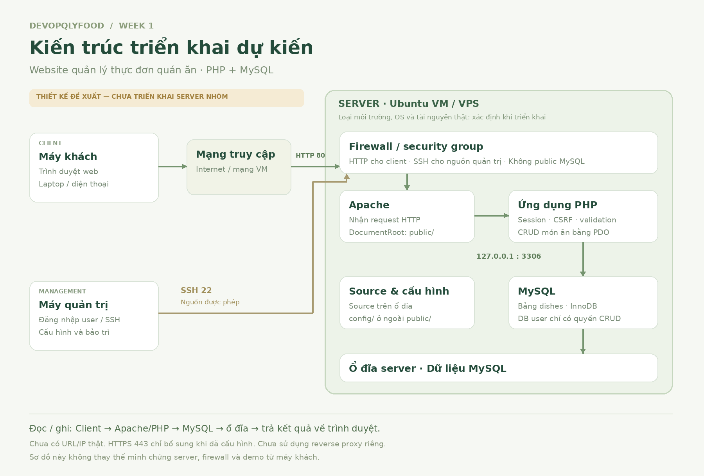

# DevopQLYFood · Website quản lý thực đơn quán ăn

**DevOps Final Project 2026 · Lộ trình 4 tuần · Checkpoint hiện tại: Week 1**

Ứng dụng PHP/MySQL giúp người quản lý thêm món, xem thực đơn, sửa giá, đổi tình trạng còn/hết và xóa món. Tên hiển thị trong ứng dụng: **Bếp Nhà**.

> **Trạng thái ngày 21/10/2026:** người triển khai xác nhận website tại [thitruongmmo.com/DevopQLYFood/public/](https://thitruongmmo.com/DevopQLYFood/public/) đã truy cập được sau khi cấu hình tài khoản admin trên hosting cPanel. Kiểm tra HTTP độc lập ngày 21/10/2026 xác nhận health endpoint trả 200 với status ok và trang đăng nhập trả 200. Đã có 3 ảnh thao tác thêm/sửa trên web và SELECT đối chiếu bản ghi ID 9 trên DB hosting. [Xem bộ minh chứng app + DB](evidence/application/demo-2026-10-21.md). Phần hạ tầng và sơ đồ hiện trạng vẫn cần hoàn thiện để kết luận đủ Week 1. [Log kiểm tra truy cập](evidence/application/http-access-2026-10-21.md). Sơ đồ PNG bên dưới vẫn là **phương án Ubuntu/VM/VPS tham chiếu**, chưa phải sơ đồ hiện trạng hosting.

**Kế hoạch hiện tại:** tận dụng hosting cPanel để kiểm tra app + DB và thu minh chứng Week 1 ngay. Kiểm tra quyền OS/SSH/firewall và khả năng chạy Docker trước khi chọn môi trường cho phần hạ tầng và Week 2; chưa xác nhận phải thuê VPS. Xem [hướng dẫn cPanel](docs/CPANEL_SETUP.md) và [kế hoạch tiếp tục](docs/DEPLOYMENT_PLAN.md).

**Đã kiểm tra source trên GitHub Actions:** PHP syntax, **14 validation checks** và **19 HTTP/MySQL integration checks** thành công với commit `4baaaa1`. [Xem run thành công](https://github.com/nathyu-le/DevopQLYFood/actions/runs/39529399926). Đây là môi trường test tạm, không phải server triển khai của nhóm.

## Tiến độ cả dự án

**Cả 4 tuần dùng chung repository này.** Source ứng dụng được cập nhật tiếp trong `app/`, `public/`, `database/` và `config/`; tiến độ, tài liệu và minh chứng được ghi theo từng checkpoint. [Xem lộ trình và nơi cập nhật](docs/ROADMAP.md).

Checklist Week 2–4 đã được đối chiếu đề chi tiết ngày 21/10/2026, có rubric, sản phẩm nộp và trình tự demo. Các mục chưa thực hiện vẫn để trống.

| Tuần | Trọng tâm | Trạng thái hiện tại | Nơi theo dõi |
|---|---|---|---|
| Week 1 | Hạ tầng và triển khai ban đầu | App đã có ảnh thêm/sửa và SELECT đối chiếu ID 9 trên hosting; còn minh chứng hạ tầng và sơ đồ hiện trạng | [Checklist](docs/WEEK1_CHECKLIST.md) · [Minh chứng](evidence/week1/README.md) |
| Week 2 | Docker/Compose và CI/CD build–test–deploy | Chưa bắt đầu triển khai; đã chuẩn bị checklist | [Checklist](docs/WEEK2_CHECKLIST.md) · [Minh chứng](evidence/week2/README.md) |
| Week 3 | Monitoring, bảo mật, backup/restore và xử lý sự cố | Chưa bắt đầu triển khai; đã chuẩn bị checklist | [Checklist](docs/WEEK3_CHECKLIST.md) · [Minh chứng](evidence/week3/README.md) |
| Week 4 | Demo tổng thể, troubleshooting, báo cáo và bảo vệ | Chưa thực hiện; đã chuẩn bị checklist | [Checklist](docs/WEEK4_CHECKLIST.md) · [Minh chứng](evidence/week4/README.md) |

**Nhóm:** Lê Đình Nhật Huy, Nguyễn Phước Hải, Lê Quang Tùng. [Xem phân công Week 1](docs/TEAM.md).

## Đi nhanh đến phần cần xem

| Nội dung | Tài liệu |
|---|---|
| Kiến trúc đề xuất | [Sơ đồ PNG](architecture.png) · [Giải thích kiến trúc](docs/ARCHITECTURE.md) |
| Cài đặt trên hosting hiện có | [Hướng dẫn cPanel](docs/CPANEL_SETUP.md) |
| Cài đặt Ubuntu/VM/VPS khi chọn môi trường đó | [Hướng dẫn Ubuntu](docs/MANUAL_SETUP.md) |
| Bổ sung Week 1 và chuyển sang Week 2 | [Kế hoạch tiếp tục](docs/DEPLOYMENT_PLAN.md) |
| Phạm vi và nguồn code | [Scope & source](docs/SCOPE_AND_SOURCE.md) |
| Phân công nhóm | [Thành viên và phân công Week 1](docs/TEAM.md) |
| Kịch bản demo ghi/đọc DB | [Demo runbook](docs/DEMO.md) |
| Trạng thái theo rubric | [Week 1 checklist](docs/WEEK1_CHECKLIST.md) |
| Minh chứng cần bổ sung | [Evidence index](evidence/README.md) |
| Kiểm tra source | [Hướng dẫn và giới hạn kiểm tra](docs/VERIFICATION.md) · [GitHub Actions](https://github.com/nathyu-le/DevopQLYFood/actions) |

## 1. Mục tiêu và chức năng

| Mã | Chức năng | Dữ liệu / kết quả |
|---|---|---|
| F01 | Đăng nhập quản trị | Tài khoản được cấu hình cục bộ; mật khẩu lưu bằng hash |
| F02 | Xem, tìm kiếm và lọc món | Đọc danh sách từ MySQL; lọc danh mục và tình trạng |
| F03 | Thêm món | Tên, danh mục, giá nguyên VNĐ, mô tả, còn/hết |
| F04 | Sửa món | Cập nhật thông tin của một món đã có |
| F05 | Đổi tình trạng phục vụ | Chuyển còn món / hết món và lưu trong DB |
| F06 | Xóa món | Xóa bản ghi được chọn; giao diện có bước xác nhận |

Phạm vi chưa bao gồm đặt món, thanh toán, giao hàng và nhiều vai trò người dùng. Mục tiêu học phần tập trung vào triển khai và vận hành, không mở rộng chức năng nghiệp vụ quá mức.

## 2. Công nghệ và yêu cầu chạy

- PHP **8.2 trở lên**, bật `pdo_mysql`, `mbstring` và session.
- MySQL **8.0 trở lên** với bảng `dishes`, charset `utf8mb4`, InnoDB.
- HTML/CSS/JavaScript thuần; không cần Node.js, npm, Composer hoặc framework để chạy ứng dụng.
- Môi trường đang dùng: hosting cPanel theo xác nhận của người triển khai; các phiên bản PHP/DB, đường dẫn và quyền server còn cần ghi nhận. Phương án Ubuntu/VM/VPS được giữ làm tham chiếu cho phần hạ tầng theo đề.



**Luồng đọc trên ứng dụng:** trình duyệt → HTTPS → web server/PHP trên hosting → SELECT database → trang HTML. Loại/phiên bản web server và vị trí DB còn cần xác minh từ tài khoản hosting.

**Luồng ghi:** form quản trị → kiểm tra đăng nhập, CSRF và dữ liệu → INSERT/UPDATE/DELETE → tải lại danh sách từ MySQL.

## 3. Cài đặt thủ công ban đầu

**Hosting cPanel đang dùng:** theo [docs/CPANEL_SETUP.md](docs/CPANEL_SETUP.md), upload source, xác nhận DocumentRoot và bảo vệ thư mục riêng, tạo DB/user, import schema và tạo cấu hình cục bộ. Không chạy các lệnh quản trị Ubuntu trên shared hosting.

**Phương án Ubuntu/VM/VPS khi chọn môi trường đó:** hướng dẫn đầy đủ tại [docs/MANUAL_SETUP.md](docs/MANUAL_SETUP.md). Các bước tham chiếu bên dưới áp dụng cho môi trường Ubuntu:

1. Chuẩn bị server, user/SSH, mạng và firewall.
2. Cài Apache, PHP, phần mở rộng PHP và MySQL.
3. Clone repository, tạo database và import `database/schema.sql`.
4. Tạo DB user chỉ có quyền `SELECT`, `INSERT`, `UPDATE`, `DELETE` cho database ứng dụng.
5. Chạy `php tools/configure.php` để tạo cấu hình và tài khoản quản trị. Script hỏi mật khẩu, tạo hash và kiểm tra kết nối DB; không in mật khẩu ra kết quả.
6. Cấu hình DocumentRoot của web server trỏ vào **`public/`**.
7. Kiểm tra từ máy khách và lưu minh chứng thật.

`config/config.example.php` chỉ là mẫu. **Không commit `config/config.local.php`.** Chỉ `public/` được phục vụ ra web; `app/`, `config/`, `database/`, `tests/` và `docs/` phải nằm ngoài DocumentRoot.

Sau khi đã có cấu hình và database, có thể kiểm tra nhanh trên máy phát triển bằng:

```bash
php -S 127.0.0.1:8080 -t public
```

Mở `http://127.0.0.1:8080`. Đây là PHP development server để kiểm tra cục bộ, không thay cho triển khai Apache và minh chứng truy cập server từ máy khách.

**Cần áp dụng trên hosting:** kiểm tra ngày 21/10/2026 thấy schema và README ở thư mục cha `public/` còn tải được qua HTTP. Repo có `.htaccess` để chỉ phục vụ `public/` cho layout cPanel hiện tại; cần upload cạnh `public/` và kiểm tra health 200, schema/README 403 theo [hướng dẫn cPanel](docs/CPANEL_SETUP.md#bảo-vệ-layout-hiện-tại). Chưa xác nhận bản chặn đã có hiệu lực trên hosting.

## 4. Database

- [database/schema.sql](database/schema.sql): tạo bảng, khóa chính, chỉ mục và ràng buộc.
- [database/seed.sql](database/seed.sql): tám món mẫu tùy chọn; chỉ import một lần nếu cần dữ liệu minh họa.
- `seed.sql` không phải minh chứng nhóm đã triển khai hoặc thao tác DB thành công.

Giá được lưu bằng `DECIMAL(12,0)`; ứng dụng chấp nhận số nguyên từ 0 đến 999.999.999 VNĐ. Danh mục có bốn lựa chọn: món chính, khai vị, đồ uống, tráng miệng.

## 5. Cấu trúc repository

| Đường dẫn | Vai trò |
|---|---|
| `public/` | Điểm vào web, đăng nhập, quản lý món, đăng xuất, health endpoint và assets |
| `app/bootstrap.php` | Kết nối PDO, session, CSRF, kiểm tra dữ liệu và escape HTML |
| `config/config.example.php` | Mẫu cấu hình không có thông tin đăng nhập thật |
| `database/` | Schema và dữ liệu mẫu |
| `docs/` | Kiến trúc, cài đặt, phân công, demo, lộ trình và checklist Week 1–4 |
| `evidence/` | Chỉ mục chung và các mục week1–week4; bổ sung ảnh/log/video thật theo tuần |
| `tests/` | Kiểm tra validation và CRUD HTTP với MySQL test riêng |
| `tools/configure.php` | Công cụ cấu hình bằng CLI |
| `.github/workflows/source-checks.yml` | Kiểm tra source trên GitHub Actions; **không triển khai ứng dụng** |

## 6. Kiểm tra và bảo mật cơ bản trong source

- PDO prepared statements cho các câu truy vấn có dữ liệu đầu vào.
- Kiểm tra quyền quản trị và CSRF trước khi ghi dữ liệu.
- Escape nội dung khi xuất HTML; kiểm tra danh mục, giá, tên và ID.
- Hash mật khẩu, đổi session ID sau đăng nhập; cookie HttpOnly và SameSite.
- Không có mật khẩu triển khai thật trong repository; file cấu hình cục bộ bị Git bỏ qua.
- `health.php` chỉ trả `ok`/`unavailable`, kiểm tra kết nối và bảng ứng dụng, không trả credentials.

Những biện pháp này nằm trong code. Cấu hình firewall, SSH, HTTPS và phân quyền trên server thật vẫn phải thực hiện và chứng minh riêng.

Workflow hiện tại chỉ lint PHP, kiểm tra validation và thử CRUD trong database tạm. **Đây chưa phải CI/CD build–test–deploy của Week 2.** Kết quả thật được xem trong tab Actions, không suy ra chỉ từ việc đã có file workflow.

## 7. Link và minh chứng triển khai

| Mục | Trạng thái |
|---|---|
| Repository | [nathyu-le/DevopQLYFood](https://github.com/nathyu-le/DevopQLYFood) |
| Website | [thitruongmmo.com/DevopQLYFood/public/](https://thitruongmmo.com/DevopQLYFood/public/) — HTTP 200 trang đăng nhập và health; có ảnh thêm/sửa và SELECT đối chiếu ID 9 |
| Môi trường server / OS / CPU / RAM / disk | Hosting cPanel; phiên bản và quyền thực tế chờ xác minh theo `evidence/server/README.md` |
| Demo ghi/đọc dữ liệu từ máy khách | Có [3 ảnh minh chứng](evidence/application/demo-2026-10-21.md): thêm ID 9, sửa giá 45.000 → 50.000đ, SELECT xác nhận 50000 và is_available 0 |
| Video / ảnh cấu hình / logs | Có ảnh app/DB và log HTTP; video, thông tin server và cấu hình mạng còn cần bổ sung |
| Thành viên và phân công Week 1 | Đã cập nhật 3 thành viên trong [docs/TEAM.md](docs/TEAM.md) |

## 8. Nguồn và đóng góp

Source khởi tạo cho đề tài này, có hỗ trợ AI khi chuẩn bị code và tài liệu; không sao chép một ứng dụng mẫu bên ngoài. Nhóm cần đọc hiểu, kiểm tra, chỉnh sửa, triển khai và ghi lại đóng góp thật. Commit khởi tạo không thay cho bằng chứng mỗi thành viên tự thực hiện phần việc.

Tài liệu kỹ thuật tham khảo: [PHP PDO](https://www.php.net/manual/en/book.pdo.php), [password_hash](https://www.php.net/manual/en/function.password-hash.php), [PHP sessions](https://www.php.net/manual/en/book.session.php), [MySQL CREATE TABLE](https://dev.mysql.com/doc/refman/8.0/en/create-table.html). Tham chiếu đầy đủ hơn và phạm vi nhóm thực hiện nằm trong [SCOPE_AND_SOURCE.md](docs/SCOPE_AND_SOURCE.md).
