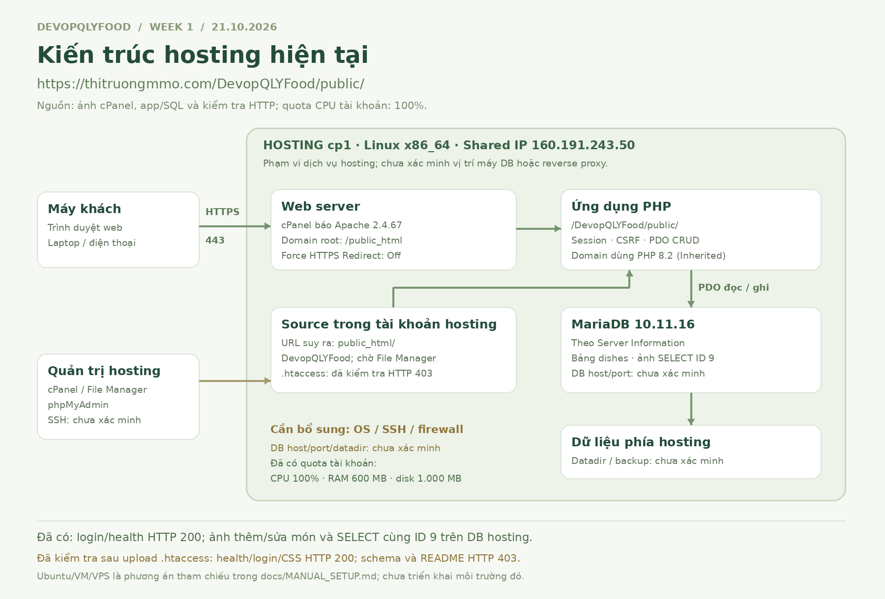

# Kiến trúc Week 1 — hosting cp1, ngày 21/10/2026

**Minh chứng lịch sử Week 1:** ứng dụng đã được truy cập tại [thitruongmmo.com/DevopQLYFood/public/](https://thitruongmmo.com/DevopQLYFood/public/). Sơ đồ mô tả các phần đã có bằng chứng; thông số chưa biết được ghi rõ. [Ảnh Server Information và Domains](../evidence/server/README.md).

Ảnh ghi nhận checkpoint Week 1. Hướng triển khai đang sử dụng được mô tả ở [kiến trúc Week 2](WEEK2_ARCHITECTURE.md); không suy ra thông số gói mới từ ảnh này.

## Thành phần ghi nhận ở Week 1

| Thành phần | Hiện trạng và bằng chứng | Chưa xác minh |
|---|---|---|
| Client / mạng | Trình duyệt truy cập HTTPS; login và health HTTP 200 | Chính sách mạng/firewall của nhà cung cấp |
| Hosting | Gói `cp1`, Linux x86_64, Shared IP `160.191.243.50`; quota CPU 100%, RAM 600 MB, disk 1.000 MB theo Statistics | Distro/version OS, tài nguyên vật lý toàn máy, quyền quản trị |
| Web server / runtime | Apache Version 2.4.67 theo Server Information; domain dùng PHP 8.2 (`ea-php82`, Inherited) theo MultiPHP Manager | PHP patch version/extensions chi tiết, cấu hình handler; chưa có bằng chứng reverse proxy riêng do nhóm cấu hình |
| Source / vùng web | Domain Document Root `/public_html`; URL app `/DevopQLYFood/public/` | Đường dẫn OS đầy đủ cần File Manager xác nhận |
| Database | MariaDB `10.11.16-MariaDB-cll-lve`; SELECT bản ghi ID 9 khớp app | DB host/port, cùng máy hay máy khác, datadir và chính sách lưu trữ |
| Quản trị | cPanel/File Manager và phpMyAdmin dùng triển khai/đối chiếu DB | cp1 không hỗ trợ Terminal theo người triển khai; giao diện SSH Access chỉ quản lý khóa. Phần đăng nhập shell/quyền user/firewall tạm hoãn bổ sung |

**Luồng đọc:** trình duyệt → HTTPS → web server/PHP của hosting → PDO SELECT bảng `dishes` → HTML về client. **Luồng ghi:** form quản trị → session/CSRF/validation → INSERT/UPDATE/DELETE → SELECT lại danh sách. [Ảnh app và SQL](../evidence/application/demo-2026-10-21.md) chứng minh thao tác thêm/sửa ID 9. DB dùng driver PDO MySQL để kết nối MariaDB; CI riêng vẫn dùng MySQL 8.0.

## Cổng và lưu trữ

- HTTPS ở URL mặc định dùng TCP 443, đã truy cập thành công. Đây không phải bằng chứng nhóm đã cấu hình firewall. Force HTTPS Redirect đang Off; không suy ra SSL bị tắt.
- Port SSH, DB port, địa chỉ DB và các port listening khác chưa được cung cấp; không ghi `127.0.0.1:3306` thành hiện trạng hosting.
- Source nằm trong tài khoản hosting; URL và Document Root cho thấy layout dự kiến `public_html/DevopQLYFood/public`. Chưa xác định đường dẫn `/home/...` đầy đủ.
- MariaDB lưu dữ liệu phía hosting; datadir, vị trí máy DB, backup và retention chưa xác minh. Không gán `/var/lib/mysql` cho hosting.

## Bảo vệ các thư mục riêng

Kiểm tra HTTP ngày 21/10/2026 thấy `database/schema.sql` và `README.md` ở thư mục cha `public/` còn tải được. Chỉ mở URL `/public/` chưa đủ để bảo vệ `config/`, `app/` và `database/`.

Repo có `.htaccess` đặt **cạnh `public/`** cho layout cPanel hiện tại, chặn mọi URL ngoài `public/`. Người triển khai đã upload; [kiểm tra HTTP sau upload](../evidence/server/http-protection-2026-10-21.md) xác nhận health/login/CSS 200, schema/README 403. Xem [CPANEL_SETUP.md](CPANEL_SETUP.md#bảo-vệ-layout-hiện-tại). Khi hosting cho phép, ưu tiên domain/subdomain riêng trỏ DocumentRoot trực tiếp vào `public/` và đặt thư mục riêng ngoài vùng web.

## Tiếp tục sau Week 1

App đã chuyển sang hosting cPanel mới ở Week 2, có pipeline build/test, deploy image staging tạm và FTPS source lên website. [Kiến trúc Week 2](WEEK2_ARCHITECTURE.md) · [Cài đặt cPanel](CPANEL_SETUP.md) · [CI/CD](CICD_SETUP.md).

Phần OS/user/SSH/firewall Week 1 còn thiếu được giữ ở [checklist](WEEK1_CHECKLIST.md), không được đánh dấu hoàn tất bởi Docker staging. Các checkpoint sau theo [lộ trình](ROADMAP.md).
