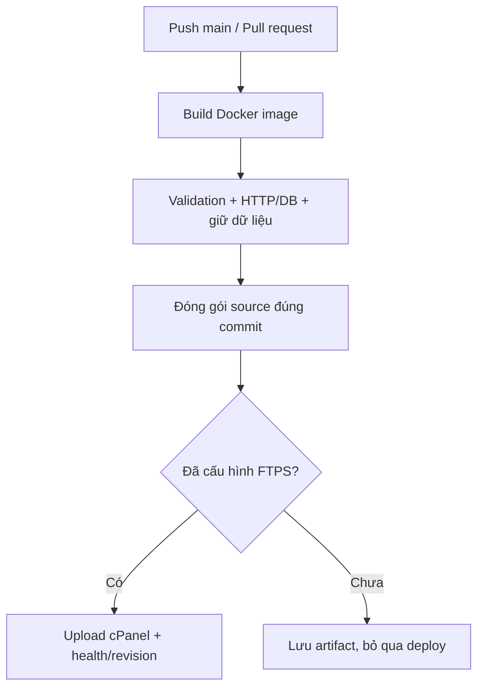

# Week 2: Docker checks và deploy lên cPanel

**Quyết định 28/10/2026: dùng gói cPanel mới đã mua, có Terminal theo người triển khai; không triển khai VPS.** Docker/Compose dùng để build và kiểm tra app + MariaDB trên GitHub Actions. Website Week 1 đã chạy PHP/MariaDB trực tiếp; chưa xác nhận môi trường và quyền Docker trên gói mới. Pipeline chuẩn bị deploy source qua **FTPS**, không cần Terminal hoặc Docker trên cPanel.

**Chưa kết nối deploy thật.** Nhà cung cấp phải bật FTP với explicit TLS/FTPS; hiện chưa có thông tin tài khoản hoặc lần kết nối xác nhận. Việc cPanel có thể quản lý website không tự chứng minh FTP/FTPS được bật. Nếu chỉ có File Manager, có thể upload gói source thủ công nhưng chưa đạt tiêu chí deploy tự động.

## Pipeline thực hiện gì?



Workflow `.github/workflows/container-pipeline.yml` chạy khi push `main` hoặc mở PR có thay đổi code/cấu hình; cũng có nút **Run workflow**. Commit chỉ sửa docs/evidence/Markdown không rebuild container. Workflow source Week 1 vẫn chạy riêng.

`container-checks` build image `devopqlyfood:<SHA>`, lint PHP, chạy 14 validation checks và kiểm tra một regression cố ý trên bản sao source. Sau đó chạy Apache/PHP/MariaDB, thử CRUD qua HTTP và PDO, tạo lại app + DB để kiểm tra cùng bản ghi còn trong volume. Bản sao lỗi phải bị đúng assertion trả exit 1; source và image thật không bị sửa.

Sau kiểm tra, pipeline tạo ZIP chỉ chứa `app/`, runtime files trong `public/` và `REVISION`. Không đóng gói config DB/admin, secrets, SQL, backup, docs hoặc `.htaccess`. Test bổ sung kiểm tra ranh giới gói source, SHA và archive paths. Artifact `cpanel-source-<SHA>` dùng cho deploy; `tested-image-<SHA>` giữ image Docker làm minh chứng, **không upload image lên cPanel**. Image/source artifacts giữ 7 ngày, logs giữ 14 ngày.

Job `deploy-cpanel` có `needs: container-checks`; chỉ chạy trên `main` khi `CPANEL_DEPLOY_ENABLED=true`. Nó tải gói source của cùng run, kiểm tra website hiện tại đang healthy rồi kết nối FTPS có kiểm tra certificate và mã hóa cả control/data channel. Script xác nhận đúng thư mục app có `app/`, `public/`, `config/` và cấu hình cục bộ trước khi upload; thay từng file bằng upload tạm rồi rename. `REVISION` được cập nhật cuối, sau đó health và phiên bản public phải khớp SHA. Script không xóa file hosting, không đổi DB và giữ nguyên `.htaccess`/`config.local.php`.

Đây là cập nhật từng file, chưa phải chuyển đổi nguyên release cùng lúc hoặc rollback tự động. Nếu upload dở, job sẽ fail; khôi phục source từ bản sao cPanel nếu cần. Sao lưu source và export DB riêng trước lần deploy đầu; không lưu bản sao chứa credentials vào Git hoặc artifact công khai.

## Kiểm tra Terminal trên gói cPanel mới trước

Chạy ba lệnh chỉ đọc, không cài đặt hoặc đổi cấu hình:

```bash
docker --version
docker compose version
docker info --format '{{.ServerVersion}}'
```

- Docker/Compose có phiên bản và `docker info` kết nối được daemon: có thể xem xét chạy Compose trên chính gói cPanel này; cần kiểm tra thêm storage/ports và cách runner kết nối trước khi bật deploy container. Không cần chuyển sang VPS.
- `command not found`, `permission denied` hoặc không kết nối được daemon: Terminal đã có nhưng Docker chưa dùng được với tài khoản. Không tự cài Docker bằng sudo hoặc suy ra có quyền root. Khi đó pipeline FTPS dưới đây là phương án deploy source, có giới hạn rubric đã ghi ở cuối.

Hiện chưa có output ba lệnh nên chưa chọn deploy container trực tiếp hay source FTPS làm kết quả cuối.

## Cấu hình deploy source qua FTPS khi áp dụng

1. Vào cPanel → **FTP Accounts**. Nếu không có mục này, xác nhận với nhà cung cấp xem gói mới có hỗ trợ **explicit FTP over TLS/FTPS** không. Phương án FTPS này không phụ thuộc Terminal.
2. Tạo **tài khoản FTP riêng cho đồ án**, giới hạn Directory đúng `public_html/DevopQLYFood`. Không dùng tài khoản có quyền sửa toàn bộ website khác. Ghi FTP Server, username đầy đủ, port và kiểu TLS theo nhà cung cấp. Certificate phải hợp lệ với FTP hostname; không tắt kiểm tra certificate để chữa lỗi.
3. Tài khoản bị giới hạn đúng thư mục trên thường dùng `CPANEL_FTP_ROOT=/`. Nếu dùng tài khoản có root khác, lấy đường dẫn FTP thực tế trỏ đến thư mục chứa `app/`, `public/`, `config/`; không suy ra từ đường dẫn cPanel.
4. Trong GitHub repo → **Settings → Secrets and variables → Actions**, thêm các biến/secrets dưới đây. Cũng có thể lưu vào environment `cpanel`; nếu mục tiêu là deploy tự động thì không bật yêu cầu người duyệt từng lần.

| Loại | Tên | Nội dung |
|---|---|---|
| Variable | `CPANEL_DEPLOY_ENABLED` | Để trống/`false` trước khi cấu hình; đổi `true` khi sẵn sàng |
| Variable | `CPANEL_FTP_HOST` | FTP hostname đúng certificate do nhà cung cấp cung cấp, không thêm `ftp://` |
| Variable | `CPANEL_FTP_PORT` | Port explicit FTPS, thường 21; script mặc định 21 |
| Variable | `CPANEL_FTP_ROOT` | Root FTP trỏ đúng thư mục đồ án; `/` khi tài khoản bị giới hạn đúng `DevopQLYFood` |
| Variable | `CPANEL_BASE_URL` | `https://thitruongmmo.com/DevopQLYFood/public/` |
| Secret | `CPANEL_FTP_USER` | Username FTP đầy đủ |
| Secret | `CPANEL_FTP_PASSWORD` | Mật khẩu tài khoản FTP riêng; nhập trực tiếp ở GitHub Secrets, không đưa vào chat/code |

5. Trên Actions, chọn **Week 2 - Docker checks and cPanel deploy** → Run workflow trên `main`. Theo dõi đủ container-checks và deploy-cpanel. Chỉ ghi deploy hoàn thành khi cả hai job qua, health 200 và `version.php` trả đúng SHA.

Nếu FTPS bị chặn hoặc hosting không hỗ trợ, job deploy vẫn chưa thể hoàn tất; File Manager chỉ là phương án upload thủ công. Không tự dùng FTP không mã hóa, đổi hosting hoặc tạo VPS.

## Demo Week 2

1. Mở website cPanel, ghi phiên bản trước qua `version.php` sau khi đã có lần deploy pipeline đầu tiên.
2. Sửa một dòng chữ dễ thấy trong `public/login.php`, commit/push `main`; ghi SHA.
3. Mở run: build Docker → tests → source artifact → deploy-cpanel. Refresh web thấy dòng mới; `version.php` phải khớp SHA. Đây là source PHP đang chạy trực tiếp trên hosting.
4. Demo test lỗi trên nhánh thử/PR riêng, không merge source lỗi. Test fail thì deploy không được chạy. Cần thu thêm run fail/ảnh trước sau để chứng minh; kiểm tra regression trên bản sao trong run xanh chưa phải toàn bộ tình huống live này.
5. Mở log persistence trên Actions: cùng ID/giá/trạng thái còn sau recreate app + DB. Có thể demo thêm Compose trên máy có Docker theo [DOCKER_SETUP.md](DOCKER_SETUP.md); không gọi đó là container đang chạy trên cPanel.

## Đối chiếu rubric

Dockerfile/Compose, image, volume và persistence đã có thể kiểm chứng trên runner. CI/CD source lên cPanel sẽ được chứng minh sau khi FTPS kết nối thành công. **Chưa chứng minh container chạy trên máy triển khai của nhóm**, vì Docker/Compose và quyền daemon trên gói mới chưa được xác minh. Nếu giảng viên yêu cầu đúng điều đó, cách dùng Docker trên CI và PHP trực tiếp trên cPanel chưa thay thế được tiêu chí ấy; cần trình bày rõ để giảng viên xác nhận cách đánh giá. Không tự đánh dấu đủ Week 2.

Tham khảo: [cPanel FTP Accounts](https://docs.cpanel.net/cpanel/files/ftp-accounts/), [giới hạn FTP vào một thư mục](https://support.cpanel.net/hc/en-us/articles/4402390715543-How-to-limit-an-FTP-account-s-access-to-a-single-directory), [GitHub job dependencies](https://docs.github.com/en/actions/using-jobs/using-jobs-in-a-workflow).
