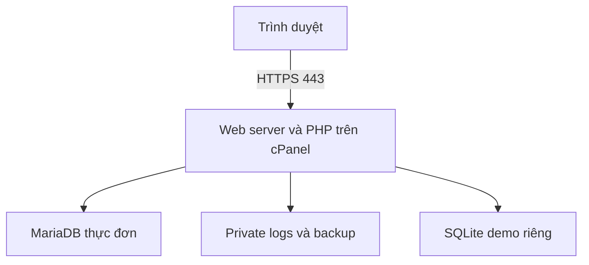
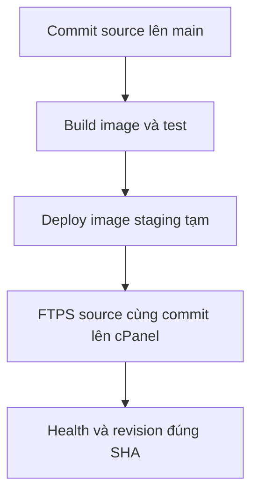

# Kiến trúc cuối kỳ Week 4

Website: https://khotrick.org/DevopQLYFood/public/ · Repository: https://github.com/nathyu-le/DevopQLYFood

## Thành phần và ranh giới

- cPanel là môi trường website live; không chạy Docker trên hosting. Nhà cung cấp quản lý web server, OS và dịch vụ MariaDB. Chưa có bằng chứng nhóm tự quản trị firewall/root/SSH của máy chủ live.
- Docker staging là runner Ubuntu tạm, app PHP 8.2 Apache và MariaDB 10.11. Image được build một lần, chuyển artifact và so image ID trước khi staging chạy `--no-build`. Không coi runner là VPS hoặc hosting của website.
- App quản lý đăng nhập và CRUD thực đơn. PDO prepared statements, validation, escaping, session và CSRF áp dụng cho thao tác quản trị.
- `/public/health.php` đọc MariaDB, trả trạng thái tối giản. `/public/version.php` trả revision; khớp SHA run là bằng chứng source đã cập nhật.
- `/public/operations.php` và ops-api yêu cầu admin. Dashboard cập nhật 5 giây khi mở trang, giữ 60 mẫu; CPU/RAM là nguồn OS/cgroup có nhãn rõ. Shared hosting có thể cho thấy số liệu OS dùng chung.
- `/public/demo.php` dùng SQLite riêng cho thực nghiệm backup/xóa/restore và ngắt kết nối. Đổi tên file SQLite làm demo-health trả 503 thật; trả tên lại thì 200. Không dừng MariaDB live. Sau 2 mẫu lỗi alert firing; sau 2 mẫu tốt về ok; tự phục hồi sau 180 giây nếu bỏ quên.
- `var/operations`, `var/backups`, `var/classroom-demo` là dữ liệu private, không đi theo gói deploy. Log chỉ ghi trường cho phép, không nội dung form/credentials.
- MariaDB chính có snapshot dữ liệu dishes riêng; demo SQLite có định dạng, demo_id và snapshot riêng. Hai loại không thay thế cho nhau.

## Cổng và dữ liệu

| Môi trường | Giao tiếp | Kiểm soát |
|---|---|---|
| Website cPanel | HTTPS 443 | Session/CSRF; private paths bị chặn HTTP |
| Cập nhật source | Explicit FTPS 21 và passive data | Xác minh certificate trên cả hai kênh; tài khoản giới hạn thư mục dự án |
| Docker staging | App bind 127.0.0.1:8080 | Không mở app ra public |
| MariaDB staging | TCP 3306 nội bộ Compose | Không publish cổng DB; user app chỉ CRUD; UFW runner kiểm chứng riêng |
| MariaDB hosting | Kết nối PHP theo cấu hình local | Host/port/quyền thực tế do hosting cấp, không suy ra từ staging |

Gói cPanel chỉ app/public và REVISION, không thay config, database, .htaccess hoặc backup. Upload từng file tạm rồi rename, REVISION cuối; chưa phải atomic release toàn ứng dụng. Rollback source cần chạy lại đầy đủ test/deploy; migration DB phải có kế hoạch riêng.

## Tài liệu vận hành

[Hướng dẫn cài mới](FINAL_DEPLOYMENT.md) · [Vận hành](OPERATIONS.md) · [Playbook](TROUBLESHOOTING.md) · [Bộ hồ sơ Week 4](WEEK4_CHECKLIST.md).
