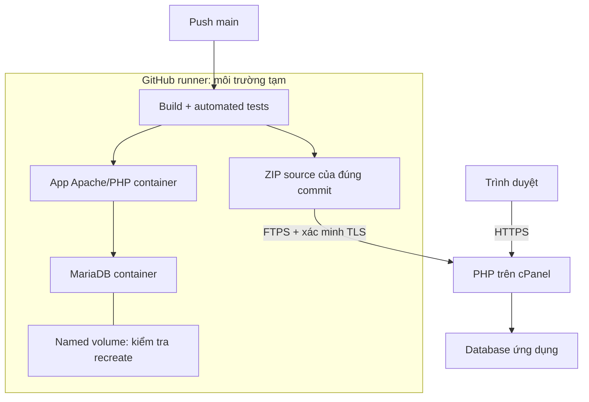

# Kiến trúc Week 2 — đã kiểm chứng ngày 28/10/2026

Có hai môi trường riêng: Docker/Compose chạy để kiểm tra trên GitHub runner; source PHP của đúng commit đã qua test được triển khai bằng FTPS lên cPanel. Không có image Docker được triển khai lên hosting.

- Compose có network và named volume. CI đã giữ cùng bản ghi qua recreate app + DB, rồi dọn stack tạm sau kiểm tra. Đây không phải volume của database cPanel.
- DB trên hosting đã được health endpoint truy vấn bảng `dishes` thành công. Chưa ghi nhận phiên bản engine/OS/tài nguyên mới từ kiểm tra này.
- FTP account được giới hạn vào thư mục dự án; client kiểm tra certificate TLS và chỉ gửi runtime source. Config thật, SQL, DB và `.htaccess` không nằm trong gói cập nhật.
- Deploy có pre-check health và post-check health/revision. Đã có run pre-check thất bại dừng trước khi truyền file, và run từ push thành công.
- Hosting có Terminal nhưng `docker` trả `command not found`. Sơ đồ không thể hiện container trên hosting; phần yêu cầu này chưa được chứng minh.

[Run thành công](https://github.com/nathyu-le/DevopQLYFood/actions/runs/40633267900) · [Trước/sau](../evidence/week2/deploy-2026-10-28.md) · [Thiết lập](CICD_SETUP.md).
