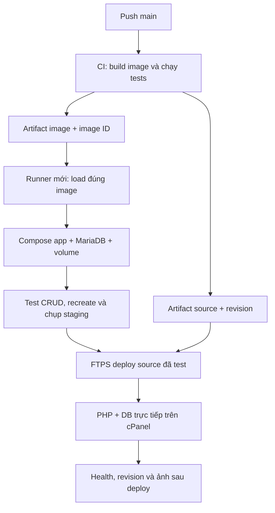

# Kiến trúc Week 2 — 28/10/2026

Ba job dùng ba runner độc lập: CI build/test, staging triển khai đúng image đã test, rồi FTPS cập nhật website cPanel. Docker staging là môi trường tạm; live dùng PHP/DB trực tiếp trên hosting hiện có.

| Môi trường | Được chạy | Dữ liệu và vòng đời |
|---|---|---|
| container-checks | Build app, lint/validation/regression, Compose HTTP/DB/persistence, package | DB test riêng, credentials ngẫu nhiên, dọn sau job |
| deploy-staging | Tải artifact image, kiểm tra image ID, `up --no-build`, 17 checks và ảnh Chrome | DB riêng trên runner mới; giữ volume khi recreate, dọn sau khi lưu evidence |
| deploy-cpanel / live | FTPS upload runtime source, health/revision và ảnh Chrome | Config và DB hosting giữ ngoài package; không dùng DB staging |

`deploy-staging` cần `container-checks` success. `deploy-cpanel` cần cả hai job trên success và flag `CPANEL_DEPLOY_ENABLED=true`. PR không deploy. Run validation lỗi thật đã có cả hai job deploy skipped; nhánh demo không được merge.

Staging so sánh image ID sau `docker load` với ID đã xuất ở CI, rồi dùng `--no-build`; không build lại app trên runner deploy. Image/source mang cùng commit revision. Staging chụp website live trước khi cập nhật, cPanel chụp lại sau cập nhật.

FTPS xác minh certificate TLS; FTP account giới hạn thư mục dự án. Gói source không chứa config thật, SQL, DB, backup hoặc `.htaccess`. Upload dùng file tạm rồi rename và ghi REVISION cuối; chưa phải cơ chế đổi toàn bộ release nguyên tử hoặc rollback DB.

Terminal cPanel từng trả `docker: command not found`; pipeline này không phụ thuộc Docker trên cPanel. Ảnh đề Week 2 không ghi phải chạy Docker ngay trên hosting. Thông số OS/engine/quota của gói mới chưa được suy ra từ kết quả CI hoặc ảnh hosting cũ.

[Run thành công](https://github.com/nathyu-le/DevopQLYFood/actions/runs/40634997505) · [Minh chứng](../evidence/week2/completion-2026-10-28.md) · [Thiết lập](CICD_SETUP.md).
