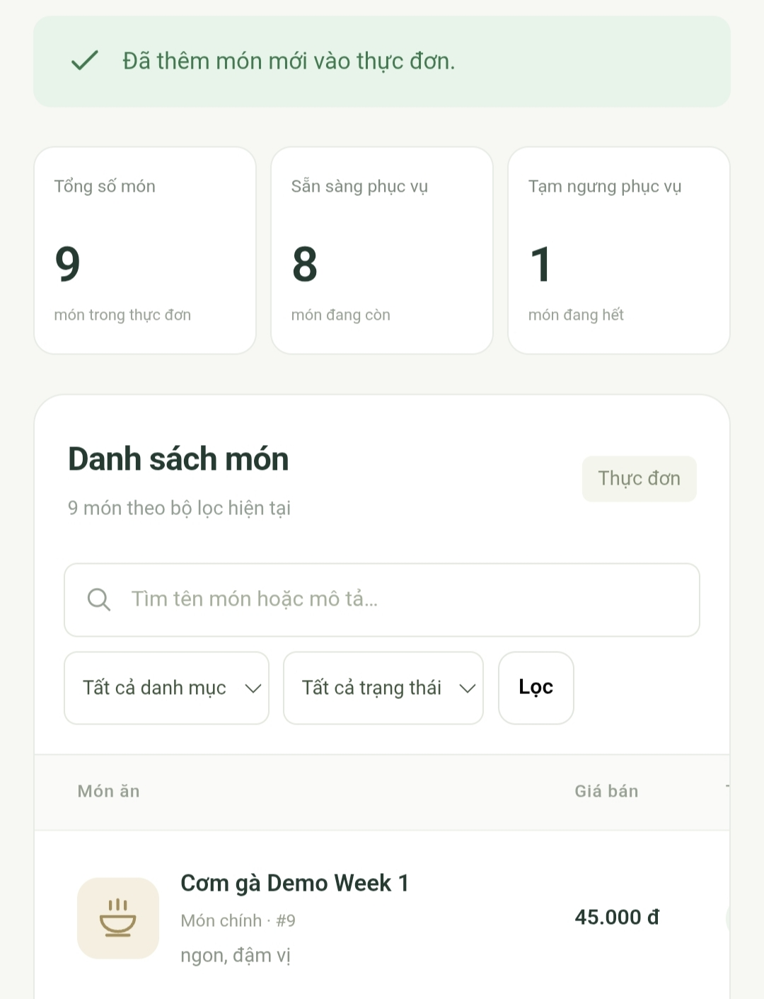
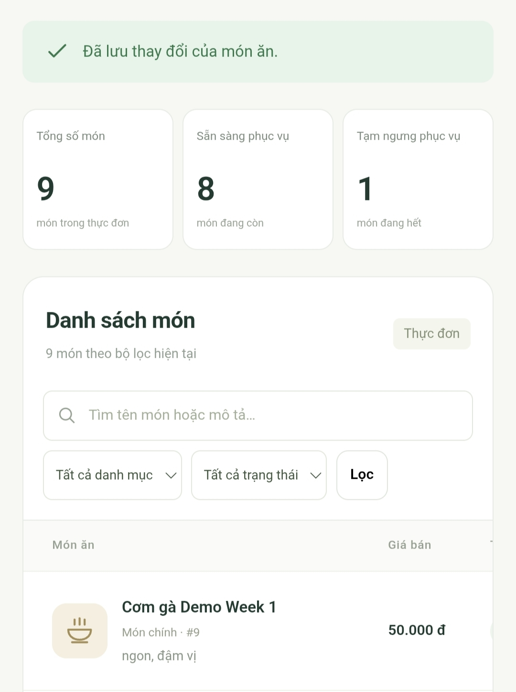
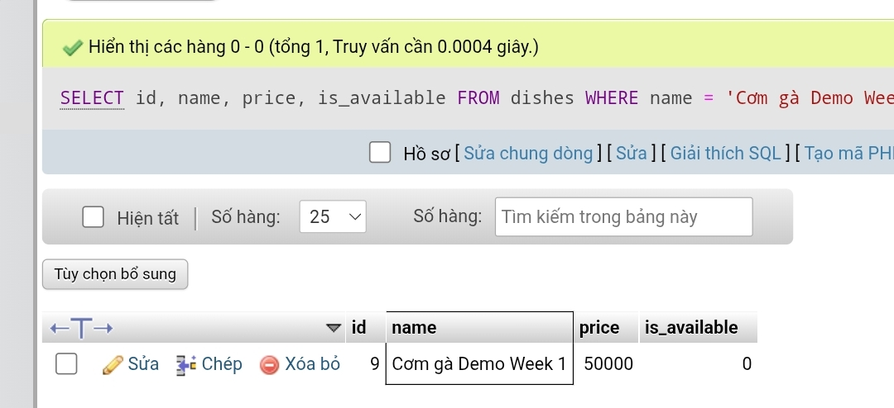

# Minh chứng thêm/sửa món và đối chiếu DB — 21/10/2026

- Website: https://thitruongmmo.com/DevopQLYFood/public/
- Môi trường: hosting cPanel.
- Nguồn: 3 ảnh đã được người cung cấp cắt bỏ phần trình duyệt và cho phép đăng công khai ngày 21/10/2026; sử dụng nguyên bản ảnh đã cắt.
- Người thao tác từng bước: cần bổ sung tên theo công việc thực tế. Phân công trong TEAM.md không tự thay cho xác nhận ai đã thao tác.

## Kết quả đối chiếu

| Bước | Tên món | ID | Giá | Trạng thái và kết quả |
|---|---|---:|---:|---|
| Thêm món trên web | Cơm gà Demo Week 1 | 9 | 45.000đ | Có thông báo “Đã thêm món mới vào thực đơn.” |
| Sửa giá trên web | Cơm gà Demo Week 1 | 9 | 50.000đ | Có thông báo “Đã lưu thay đổi của món ăn.” |
| SELECT trong phpMyAdmin | Cơm gà Demo Week 1 | 9 | 50000 | `is_available = 0` (hết món); truy vấn trả 1 hàng |

Tên, ID và giá sau sửa khớp giữa giao diện và DB. Ảnh đầu cho thấy 9 món tổng cộng sau khi thêm; ảnh sửa cũng hiển thị cùng món ID 9.

## 1. Thêm món

Ảnh đã cắt `1000003666.jpg`. Bản ghi ID 9 có tên và giá 45.000đ kèm thông báo thêm thành công.



## 2. Sửa giá

Ảnh đã cắt `1000003664.jpg`. Cùng ID 9 hiển thị giá 50.000đ và thông báo lưu thay đổi thành công.



## 3. SELECT đối chiếu database

Ảnh đã cắt `1000003665.jpg`. Kết quả có một hàng với ID 9, tên món khớp, price 50000 và is_available 0.

Truy vấn đối chiếu:

```sql
SELECT id, name, price, is_available
FROM dishes
WHERE name = 'Cơm gà Demo Week 1';
```



## Phạm vi và phần cần bổ sung

Bộ ảnh chứng minh thêm món, cập nhật giá và đọc/đối chiếu cùng bản ghi trong DB hosting. Ảnh web chưa hiển thị cột trạng thái; kết luận hết món trong báo cáo này dựa vào SQL chụp sau đó. Không suy ra trạng thái web ở ảnh trước đó đã bằng 0.

Bước tải lại/tìm kiếm riêng, thao tác xóa và một video liền mạch chưa thể hiện trong bộ ảnh. Có thể bổ sung ảnh web sau tải lại thấy rõ ID 9, giá 50.000đ và “Hết món”, hoặc quay chuỗi thao tác theo [DEMO.md](../../docs/DEMO.md).

Đã bổ sung [ảnh server/domain và thông tin hosting](../server/README.md) cùng sơ đồ hiện trạng. PHP version, tài nguyên, quyền user/SSH, firewall/ports và vị trí DB còn cần xác minh để đối chiếu toàn bộ Week 1.
