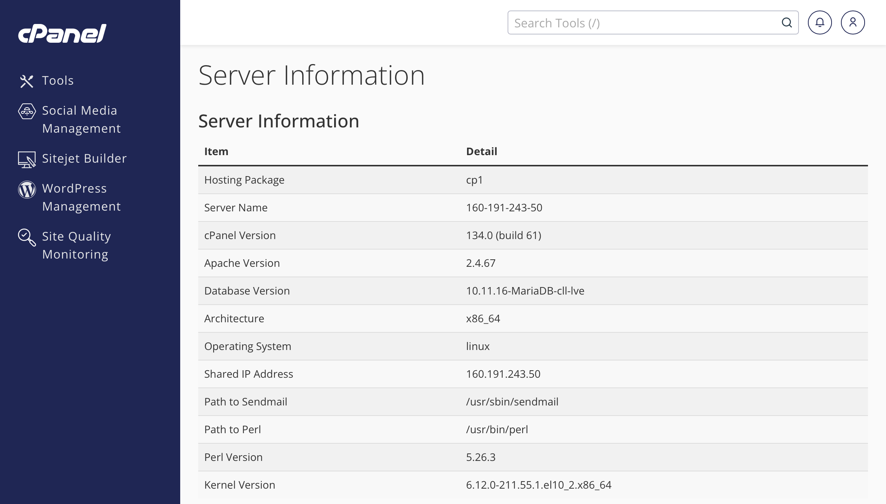
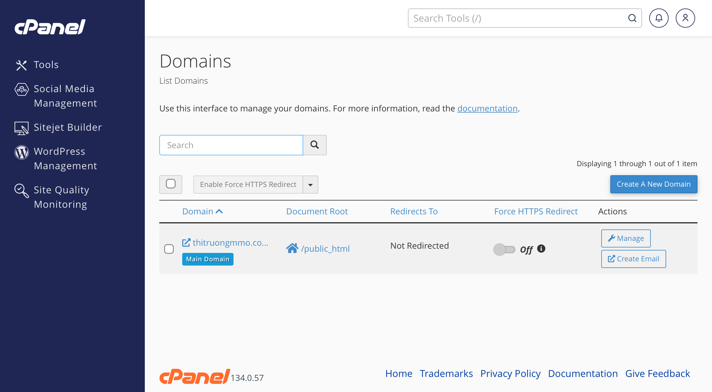
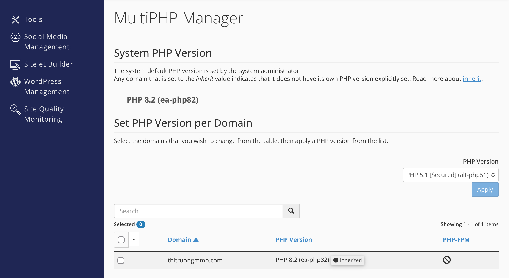
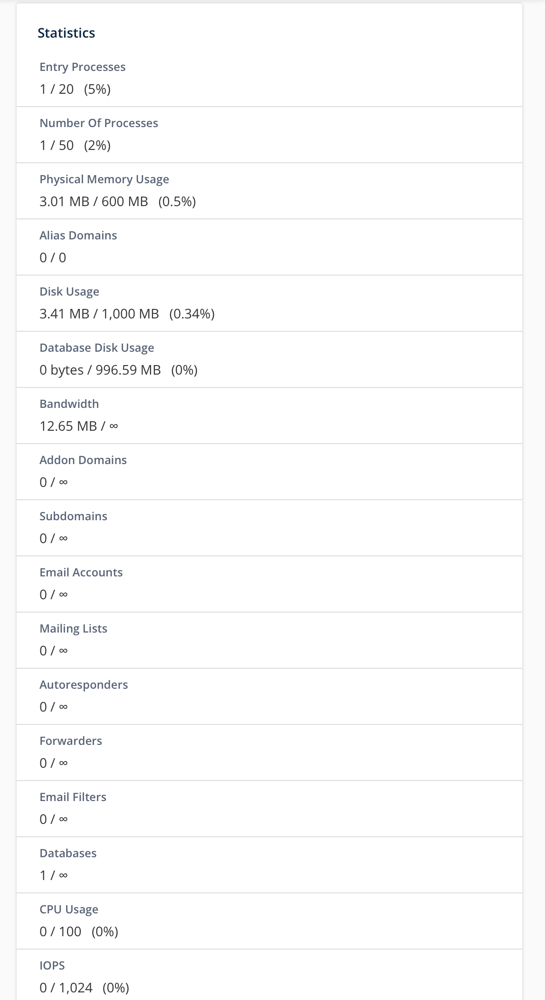
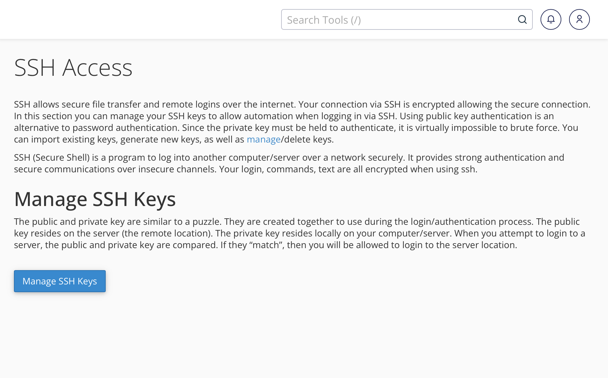

# Cấu hình hosting đang dùng — 21/10/2026

Nguồn: ảnh cPanel do người triển khai cung cấp để minh chứng Week 1, cùng kết quả HTTP độc lập. Số liệu quota thuộc tài khoản hosting; không suy ra CPU, RAM hay dung lượng vật lý của toàn server.

| Thông tin | Giá trị quan sát |
|---|---|
| Môi trường / gói | Hosting cPanel, Hosting Package `cp1` |
| OS / kiến trúc | `linux`, `x86_64`; chưa xác định distro/version OS |
| Kernel | `6.12.0-211.55.1.el10_2.x86_64` |
| cPanel | Server Information báo `134.0 (build 61)` |
| Web server | Apache Version `2.4.67` theo Server Information |
| Database | `10.11.16-MariaDB-cll-lve` theo Server Information |
| PHP của domain | PHP **8.2** (`ea-php82`), **Inherited**, theo MultiPHP Manager; chưa có patch version/extensions chi tiết |
| CPU quota tài khoản | Statistics hiển thị **0 / 100 (0%)**, giới hạn CPU 100%; không ghi là 100 CPU hoặc suy ra cấu hình CPU vật lý |
| RAM quota tài khoản | Physical Memory Usage **3.01 MB / 600 MB (0.5%)** tại thời điểm chụp |
| Disk quota tài khoản | Disk Usage **3.41 MB / 1,000 MB (0.34%)** tại thời điểm chụp |
| Shared IP Address | `160.191.243.50`, IP dùng chung theo cPanel |
| Domain / Document Root | `thitruongmmo.com`, `/public_html`; chưa phải đường dẫn OS đầy đủ |
| Website | `https://thitruongmmo.com/DevopQLYFood/public/` |
| Redirects To / Force HTTPS Redirect | `Not Redirected` / `Off` lúc chụp; HTTPS vẫn truy cập được |
| User / SSH / firewall | Người triển khai xác nhận **cp1 không hỗ trợ Terminal**. Có ảnh **SSH Access / Manage SSH Keys**, chưa có đăng nhập shell thành công, user/quyền, SSH port hoặc firewall; phần này tạm hoãn bổ sung |
| Source / DB host, port, datadir | URL suy ra source ở `public_html/DevopQLYFood`, chờ File Manager xác nhận đường dẫn OS; DB host/port/datadir chưa được cung cấp |
| Bảo vệ thư mục riêng | Người triển khai đã upload `.htaccess`; health/login/CSS 200, schema/README 403 theo [log kiểm tra](http-protection-2026-10-21.md) |

## Ảnh thông tin server và domain

## Ảnh PHP và quota tài khoản

**Cách đọc:** lấy giá trị PHP Version ở dòng domain, không lấy ô lựa chọn để thay đổi phiên bản. Ô PHP 5.1 trong ảnh là lựa chọn chưa áp dụng; dòng domain đang là PHP 8.2.

Đây là số liệu sử dụng/giới hạn của tài khoản tại thời điểm chụp. Giá trị Database Disk Usage hiển thị 0 trong Statistics không thay thế truy vấn dữ liệu; app và ảnh SELECT đã chứng minh có bản ghi trên database.

## Giao diện SSH Access

Ảnh mới xác nhận giao diện quản lý khóa xuất hiện, không có kết quả tạo/authorize khóa hoặc đăng nhập SSH. Không đánh dấu tiêu chí user/SSH/firewall đã hoàn tất từ ảnh này.

## Phần cần bổ sung theo đề

- Distro/version OS và môi trường tự cài/cấu hình server phù hợp đề, hoặc xác nhận thay thế của giảng viên.
- Đăng nhập shell thực tế bằng user được cấp quyền, phương thức/port SSH và quyền của user; không công khai private key/password.
- Firewall/security group và port listening. Chặn URL bằng `.htaccess` không thay thế firewall hệ điều hành.
- Đường dẫn OS đầy đủ, DB host/port và nơi lưu dữ liệu khi có quyền xem.

**Quyết định ngày 21/10/2026:** người triển khai xác nhận cp1 không hỗ trợ Terminal và dùng gói này để demo tạm Week 1. Tạm dừng kiểm tra Terminal/SSH trên gói hiện tại; dự kiến bổ sung phần cài/cấu hình server và firewall khi chọn VPS hoặc hosting khác cho Week 2. Khả năng SSH riêng ngoài Terminal chưa được kiểm chứng. [Kế hoạch chuyển môi trường](../../docs/DEPLOYMENT_PLAN.md). Nếu chọn Ubuntu VM/VPS, dùng [MANUAL_SETUP.md](../../docs/MANUAL_SETUP.md) và lưu kết quả thật.

Tham khảo: [cPanel MultiPHP Manager](https://docs.cpanel.net/cpanel/software/multiphp-manager-for-cpanel/), [Terminal](https://docs.cpanel.net/cpanel/advanced/terminal-in-cpanel/).
