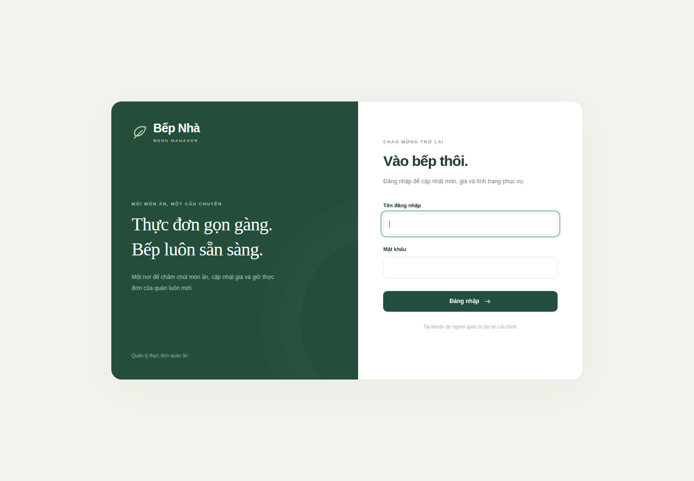

# Checkpoint Week 2 — 28/10/2026

**Kết quả:** push source commit [d18f6be](https://github.com/nathyu-le/DevopQLYFood/commit/d18f6be9b79e1ede812d5450cb34cd8ec4e0e70a) tự chạy build/test, deploy đúng image vào staging trên runner mới, rồi FTPS cập nhật website cPanel. [Run 40634997505](https://github.com/nathyu-le/DevopQLYFood/actions/runs/40634997505) **success, attempt 1**. Bộ hồ sơ gồm source, workflow, tests/logs, ảnh trước/sau và README chạy pipeline.

Nguồn minh chứng: job logs và artifacts GitHub Actions, Chrome headless chụp trang thật, health/version endpoints và JSON do container test ghi. Không gán các thao tác tự động này thành đóng góp đã thực hiện của từng thành viên.

## 1. Ba job thành công

| Job | Kết quả | Nội dung kiểm chứng |
|---|---|---|
| [container-checks](https://github.com/nathyu-le/DevopQLYFood/actions/runs/40634997505/job/122639810788) | success | Build image, PHP lint, 14 validation checks, regression, 17 container checks, gói source |
| [deploy-staging](https://github.com/nathyu-le/DevopQLYFood/actions/runs/40634997505/job/122640322915) | success | Runner mới load artifact, so image ID, Compose --no-build, 17 checks, persistence JSON và ảnh |
| [deploy-cpanel](https://github.com/nathyu-le/DevopQLYFood/actions/runs/40634997505/job/122640674777) | success | FTPS source, health/revision và ảnh sau deploy |

[Source checks cùng source commit](https://github.com/nathyu-le/DevopQLYFood/actions/runs/40634997549) cũng success. [Log chọn lọc](completion-2026-10-28.log) giữ nguyên dòng kết quả và timestamp từ logs gốc, bỏ các phần môi trường/kết nối.

Image ID tại CI và staging:

```text
sha256:3b8576ad8276e5086455b3fd5c383903ce6979049bb92224ee04fb245d244ae9
```

[File image ID](tested-image-id-2026-10-28.txt). Job staging tải `tested-image-d18f6be9b79e1ede812d5450cb34cd8ec4e0e70a`, chạy `docker load`, so ID, rồi `docker compose up -d --no-build`; không build lại app trên runner deploy.

## 2. Ảnh phiên bản trước/sau

| Quan sát | Live trước cập nhật | Docker staging | Live sau cập nhật |
|---|---|---|---|
| Revision | 6583790e9850d7cdbdfa9aebac1bc896781dbcfb | d18f6be9b79e1ede812d5450cb34cd8ec4e0e70a | d18f6be9b79e1ede812d5450cb34cd8ec4e0e70a |
| Health | ok | ok | ok |
| Ảnh | [live-before-login.png](screenshots/live-before-login.png) | [staging-login.png](screenshots/staging-login.png) | [live-after-login.png](screenshots/live-after-login.png) |
| Metadata | [live-before-check.json](screenshots/live-before-check.json) | [staging-check.json](screenshots/staging-check.json) | [live-after-check.json](screenshots/live-after-check.json) |

Câu login trước: **“Đăng nhập để cập nhật món ăn và quản lý thực đơn của quán.”**

Câu login mới: **“Đăng nhập để cập nhật món, giá và tình trạng phục vụ.”**

Ảnh 1440×1000 do Chrome chụp tự động trong chính run này; không chỉnh sửa và không đăng nhập quản trị. Ảnh staging/live-after giống nhau vì UI cùng source; metadata cho biết URL và revision mỗi môi trường. Metadata là kết quả health/version cùng lượt chụp, không phải thông tin được vẽ lên ảnh.

**Trước deploy — live cPanel**


**Sau deploy — live cPanel**



**Image đã deploy — staging Docker tạm**


Website: [login](https://khotrick.org/DevopQLYFood/public/login.php) · [health](https://khotrick.org/DevopQLYFood/public/health.php) · [version](https://khotrick.org/DevopQLYFood/public/version.php). Khi chỉ cập nhật docs/evidence, version live tiếp tục là source commit trên, không bắt buộc bằng HEAD tài liệu.

## 3. DB persistence qua recreate

[JSON kết quả thật](persistence-2026-10-28.json), project `devopqlyfood_staging_ci`:

| Trường | Trước recreate | Sau recreate |
|---|---|---|
| id | 1 | 1 |
| name | Container CI d64df0c415dc1ed5563c | Container CI d64df0c415dc1ed5563c |
| price | 50000 | 50000 |
| is_available | 0 | 0 |

Test đã thêm món qua HTTP, sửa giá/trạng thái, đọc từ MariaDB, recreate cả app và DB, đọc lại và xác nhận `same_record_preserved: true`. Web container mới cũng đọc được bản ghi. Sau kiểm chứng, test xóa bản ghi thử; workflow dọn stack/volume tạm.

Đây là **DB staging**, không phải DB cPanel. Named volume được giữ trong bước recreate; việc dọn volume chỉ xảy ra sau khi hoàn tất kiểm chứng môi trường tạm.

## 4. Test thất bại làm pipeline fail

[Run 40635078470](https://github.com/nathyu-le/DevopQLYFood/actions/runs/40635078470) trên draft [PR #1](https://github.com/nathyu-le/DevopQLYFood/pull/1), commit `19f9878063eb89a5d8a454a5dff348b2aced5e9c`. Nhánh demo cố ý nới validator để nhận giá vượt giới hạn; test thật phát hiện:

```text
FAIL: reject invalid price: 1000000000
Process completed with exit code 1.
```

| Job | Kết quả |
|---|---|
| container-checks | failure tại validation |
| deploy-staging | skipped |
| deploy-cpanel | skipped |

PR đã **đóng, không merge**; main/live giữ validator hợp lệ. PR cũng có branch guard không deploy, còn dependency `needs` yêu cầu tests/staging success trước khi deploy main. Không dùng lệnh exit 1 giả làm automated test, không tắt test để đưa nhánh lỗi lên live.

## 5. Đối chiếu đề và hồ sơ nộp

| Tiêu chí | Tối đa | Source/minh chứng |
|---|---:|---|
| Dockerfile + Compose build/run | 0,7 | [Dockerfile](../../Dockerfile), [Compose](../../docker-compose.yml), image ID và hai job CI/staging |
| Persistent volume | 0,3 | JSON cùng bản ghi qua recreate ở mục 3 |
| CI/CD build/test/deploy tự động | 1,2 | [Workflow](../../.github/workflows/container-pipeline.yml), run pass và fail |
| Commit → pipeline → app update | 0,3 | Commit d18f6be, ba job, ảnh trước/sau và version public |

[Tests](../../tests/) + logs ở mục 1/4; ảnh ở mục 2 đáp ứng lựa chọn **video/ảnh**; [README](../../README.md), [Docker setup](../../docs/DOCKER_SETUP.md), [CI/CD setup](../../docs/CICD_SETUP.md) hướng dẫn chạy. Điểm thực tế do giảng viên đánh giá.

Ảnh đề gốc Week 2 `1000003653.jpg` đã đọc lại ngày 28/10/2026: không ghi bắt buộc Docker chạy ngay trên cPanel. Kiến trúc hiện tại triển khai image vào staging tạm và source cùng commit lên cPanel; không tuyên bố hosting chạy Docker. [Checklist đầy đủ](../../docs/WEEK2_CHECKLIST.md).

## 6. Phạm vi và cách xem lại

Image/source artifacts giữ 7 ngày, log/ảnh artifacts giữ 14 ngày theo workflow. Ảnh, JSON, image ID và log chọn lọc của checkpoint đã lưu trong Git để xem lại sau khi artifacts hết hạn. [Chỉ mục artifacts/run](run-40634997505.json) ghi IDs và trạng thái đã xác minh.

Staging được dọn sau run, chỉ truy cập localhost của runner khi job đang chạy. cPanel là website live; DB/config hosting không nằm trong ZIP, không có migration hoặc rollback DB tự động. Không công khai hostname/tài khoản FTP, mật khẩu, config thật hoặc private keys trong bộ minh chứng.

OS/user/SSH/firewall Week 1 còn thiếu giữ ở checklist riêng; không đánh dấu Week 3–4 xong. Nhóm cần mở thử các link bằng tài khoản dùng khi nộp, đọc hiểu và tập [kịch bản một người](../../docs/WEEK2_DEMO.md).
